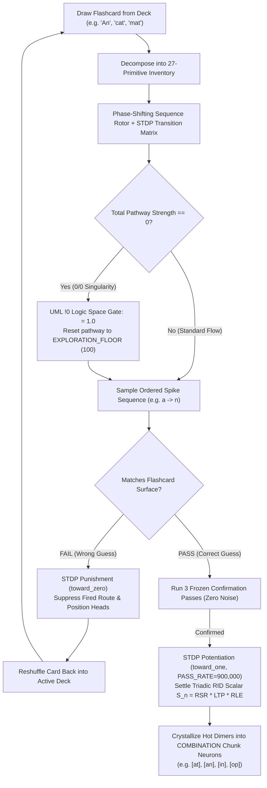

# AIOS Viv — Unified Emergent Neural Network Record (`NN_record.md`)

**Project Root:** `L:\LocalCoder`  
**Active Integration Workspace:** `L:\LocalCoder\workspace`  
**Unified Brain Engine:** [`L:\LocalCoder\workspace\INN\inn\unified_brain.py`](file:///L:/LocalCoder/workspace/INN/inn/unified_brain.py)  
**UML `!0` Logic Space Gate:** [`L:\LocalCoder\workspace\INN\inn\uml_neural_gate.py`](file:///L:/LocalCoder/workspace/INN/inn/uml_neural_gate.py) & [`L:\LocalCoder\UML_Calc\uml_engine.py`](file:///L:/LocalCoder/UML_Calc/uml_engine.py)  
**Origin Steel Brain Store (Read-Only Canonical):** `L:\Standalone\NN\data\steel_brain_live_emergence_100k_from_3letter_start_v1\steel_brain_live_emergence_100k_from_3letter_start_v1.sqlite3`  
**Last Verified:** 2026-10-31

---

## 1. Executive Summary: What This System Is and What It Does

**AIOS Viv (`UnifiedVivBrain`)** is an emergent, bottom-up neural-symbolic learning architecture that unifies three previously separate engines on `L:\`:
1. **The Steel Brain Neuron Graph (`L:\Standalone\NN`)**: `101,252` addressable neurons (`12,584` `STABLE` 1–4 letter `WORD` neurons, `COMBINATION` syllable/dimer chunks, and `CHARACTER` foundation primitives) governed by 4-head `SparseNeuronAttention` and fixed-point Hebbian/STDP synapses (`SCALE = 1,000,000`).
2. **The Universal Machine Language (`UML_Calc`) & `!0` Logic Space Engine (`L:\LocalCoder\UML_Calc`)**: A deterministic mathematical engine where division-by-zero and complete pathway collapse resolve to `!0` (**Logic Space**) rather than `NaN` or `ZeroDivisionError`:
   - **Self-Containment Identity (Unity):** $\langle !0, !0 \rangle = \frac{0}{0} = 1.0$ (`UML_CEILING_UNITY`)
   - **Null Compression (Zero):** $\langle !0, 0 \rangle = \frac{x}{0} = 0.0$ (`UML_FLOOR_ZERO`)
3. **The Grounded INN Toddler Language & Farm Engine (`L:\LocalCoder\workspace\INN`)**: A character-grounded neural language and concept engine (`GroundedINN`) trained across three developmental stages (**Stage 1: Spelling & Unscrambling**, **Stage 2: Neuron-Gated Toddler Speaking**, **Stage 3: Grounded Word Meaning**).

---

## 2. How the Emergent Learning Works (The 27-Primitive Flashcard Architecture)

Unlike standard LLMs that ingest pre-tokenized subword vectors, Viv begins with **only 27 hardcoded foundation primitives**:
- **26 Lowercase Letter Neurons (`a` through `z`)**: Each mapped to a deterministic `CHARACTER` neuron ID (`stable_character_neuron_id('a')`, etc.).
- **1 `SHIFT` Modifier Neuron (`<SHIFT>`)**: `SHIFT_NEURON_ID = N-104120F52EFB3A3D25DDBD8EC7992484`.
  - Capitalization is never hardcoded as a separate alphabet; it is **compositional**:
    $$\text{SHIFT} + \text{a} \longrightarrow \text{A}$$
    $$\text{"An"} \longrightarrow [\text{"<SHIFT>"}, \text{"a"}, \text{"n"}]$$

### 2.1 The Flashcard Guessing & Deck Reshuffle Loop (`run_emergent_flashcard_deck`)



### 2.2 Time, Sequence, and Synaptic Plasticity (STDP)
1. **Phase-Shifting Sequence Rotor (`rotor_state`)**: Because `"an"` ($\text{a} \rightarrow \text{n}$) is different from `"na"` ($\text{n} \rightarrow \text{a}$), every spike at position $p$ shifts the phase of `rotor_state`:
   $$\text{rotor}_{p+1} = \left( \frac{(\text{rotor}_p + k_i) \cdot \text{pos\_factor}}{\text{SCALE}} + \frac{\text{rem\_total} \cdot \text{SCALE}}{L} \right) \bmod \text{SCALE}$$
2. **STDP Reward (`toward_one`) & Punishment (`toward_zero`)**:
   - **On `PASS`**: Both the card-local route and the **cross-card shared transition matrix (`shared_links[(prev_tok, curr_tok)]`)** and **relative positional heads (`shared_rel_heads[(START/MID/END, tok)]`)** are potentiated via `toward_one(weight, PASS_RATE=900_000)`:
     $$w_{\text{new}} = w + \frac{(1{,}000{,}000 - w) \cdot 900{,}000}{1{,}000{,}000}$$
   - **On `FAIL`**: The specific wrong route is suppressed via `toward_zero(weight, FAIL_LINK_RATE=150_000)` down to `EXPLORATION_FLOOR = 100`, and the flashcard is **reshuffled back into the deck**.
3. **Emergent Dimer Crystallization (`COMBINATION` Neurons)**:
   - When a 2-letter transition ($\text{a} \rightarrow \text{t}$, $\text{a} \rightarrow \text{n}$, $\text{i} \rightarrow \text{n}$, $\text{o} \rightarrow \text{p}$) is mastered or fires across $\ge 2$ words with synaptic weight $\ge 850{,}000$, Viv automatically crystallizes it into an addressable `COMBINATION` chunk neuron (`[at]`, `[an]`, `[in]`, `[op]`).
   - Subsequent words in that rhyme family immediately recognize `[at]` as a fused rhyme nucleus (`MID -> END`), reserving the new consonant for `START` (`b + [at]`, `c + [at]`, `m + [at]`).

### 2.3 RID Stability Math ($S_n$)
Every flashcard and every training epoch is governed by the Recursive Information Density (RID) scalar:
$$S_n = \text{RSR} \times \text{LTP} \times \text{RLE}$$
- **$\text{RSR}$ (Identity Continuity)**: $\frac{\text{SpellingAcc} + \text{SpeakingAcc} + \text{MeaningAcc}}{3}$
- **$\text{LTP}$ (Long-Term Potentiation)**: $\min\left(1.0, \frac{N_{\text{mastered}}}{N_{\text{target}}}\right)$
- **$\text{RLE}$ (Recursive Learning Efficiency)**: $\text{clamp}\left(1.0 - \frac{\mathcal{L}_{\text{after}}}{\max(\mathcal{L}_{\text{before}}, 1.0)}, 0.0, 1.0\right)$

---

## 3. Experimental Proofs of Emergence

### Proof 1: Compositional `<SHIFT>` Generalization (`"An"` $\rightarrow$ `"In"` in 1 Try)
**Run ID:** [`20261031T173125664161Z`](file:///L:/LocalCoder/workspace/autonomy/learning/unified_viv_runs/20261031T173125664161Z/unified_viv_training_manifest.json)
- On flashcard **`"An"`** (`["<SHIFT>", "a", "n"]`), Viv initially guessed `"an"` (`["a", "n", "<SHIFT>"]`)—attempting to put the `<SHIFT>` modifier at the end of the word.
- STDP punishment suppressed `("END", "<SHIFT>")` and potentiated `("START", "<SHIFT>")`.
- On the next draw, she fired `["<SHIFT>", "a", "n"]` $\rightarrow$ **`"An"` (`PASS`)**.
- When presented with **`"In"`** (`["<SHIFT>", "i", "n"]`), she transferred `<SHIFT>` at `START` and `n` at `END`, mastering **`"In"` on Attempt 1 with 0 reshuffles and 0 punishments ($S_n = 0.95$)**.

---

### Proof 2: The `-at` Rhyme Family & Emergent Dimer Fusion (`["at", "bat", "cat", "hat", "mat", "pat", "rat", "sat"]`)
**Command:**
```powershell
powershell -ExecutionPolicy Bypass -File L:\LocalCoder\Speak-UnifiedViv.ps1 -Flashcards "at,bat,cat,hat,mat,pat,rat,sat"
```
- **Before Cross-Card STDP Transfer:** `Cat` alone required **`39` attempts** (`38` reshuffles) of random anagram permutation (`"act"`, `"atC"`, `"cTa"`, `"tAc"`, etc.).
- **With Cross-Card STDP Transfer & Dimer Crystallization:** The **entire 8-word `-at` deck** was mastered in **`27` total draws (`19` reshuffles)**:
  - Look at Round 1's rejected guesses for `bat`, `pat`, `rat`, `sat`: she guessed **`"atb"`**, **`"atp"`**, **`"atr"`**, **`"ats"`**—meaning she **already fused `a -> t` into an unbroken unit (`at*`)** and only had to learn to place the onset consonant in front (`b + [at]`)!
  - By Round 2, she crystallized the `COMBINATION` neuron **`[at]` (`N-80871943017949E8B4217D33F6B0FA63`, weight `999,999 / 1,000,000`)**.
  - **`mat`** passed on **Attempt 1 (`0` reshuffles, $S_n = 0.95$)**, and **`cat`** passed on **Attempt 2 (`1` reshuffle)**.

---

### Proof 3: Scaling to a 26-Word Multi-Family Rhyme Deck (`-at`, `-an`, `-in`, `-op`)
**Command:**
```powershell
powershell -ExecutionPolicy Bypass -File L:\LocalCoder\Speak-UnifiedViv.ps1 -Flashcards "at,bat,cat,hat,mat,pat,rat,sat,an,can,fan,man,pan,ran,in,bin,fin,pin,tin,win,op,cop,hop,mop,pop,top"
```

#### Summary Metrics (26-Card Multi-Family Run)
- **Deck Size:** `26` words across 4 rhyme families (`-at`, `-an`, `-in`, `-op`)
- **Mastered:** **`26 / 26` (`100%`)**
- **Total Draws Across All 26 Cards:** **`62` draws** (an average of **`2.38` attempts per word** across 26 words!)
- **First-Try (`Attempt = 1`, `0` Reshuffles) Passes:** **`8` words** (`mat`, `an`, `can`, `man`, `in`, `win`, `op`, `pop`)
- **Second-Try (`Attempt = 2`, `1` Reshuffle) Passes:** **`7` words** (`at`, `bat`, `cat`, `pat`, `pan`, `fin`, `pin`)
- **Crystallized `COMBINATION` Dimer Neurons:** **`8` chunks** automatically discovered and locked (`[an]`, `[in]`, `[op]`, `[at]`, `[ma]`, `[ca]`, `[pa]`, `[ra]`)

#### Crystallized `COMBINATION` Neurons Discovered During the 26-Card Run

| Dimer Chunk | Combination Neuron ID | Child Primitives | Crystallized On Card | Round | Synaptic Weight (`SCALE=1,000,000`) | Mastered Word Uses | Algebraic Formula |
| :---: | :--- | :---: | :---: | :---: | :---: | :---: | :--- |
| **`[an]`** | `N-592C1ED5586B7FD7B0FC7E9A6464357F` | `a -> n` | `an` | Round 1 | `999,999` | `6` | `an = a + n` |
| **`[in]`** | `N-429922032674D56EFBA9BA25577D3594` | `i -> n` | `in` | Round 1 | `999,999` | `6` | `in = i + n` |
| **`[op]`** | `N-431617103462568F1DDD0053908BAA36` | `o -> p` | `op` | Round 1 | `999,999` | `6` | `op = o + p` |
| **`[at]`** | `N-80871943017949E8B4217D33F6B0FA63` | `a -> t` | `pat` | Round 2 | `999,999` | `8` | `at = a + t` |
| **`[ma]`** | `N-288E8324EDBF991B32D79E60D80A8990` | `m -> a` | `man` | Round 1 | `999,500` | `2` | `ma = m + a` |
| **`[ca]`** | `N-04B6F927B6B6FEC10C7A35A76B1B3468` | `c -> a` | `cat` | Round 2 | `999,500` | `2` | `ca = c + a` |
| **`[pa]`** | `N-610EC02115F7D2A9963A4D602036223A` | `p -> a` | `pan` | Round 2 | `995,000` | `2` | `pa = p + a` |
| **`[ra]`** | `N-DEACFB75FBEC9B6096AE02B6E78D679D` | `r -> a` | `rat` | Round 4 | `995,000` | `2` | `ra = r + a` |

#### Full 26-Card Mastery Table

| Family | Flashcard | Compositional Formula | Attempts | Reshuffles | Rejected Guesses | Settled $S_n$ |
| :---: | :---: | :--- | :---: | :---: | :--- | :---: |
| **`-at`** | `at` | `at = a + t` | `2` | `1` | `["ta"]` | `0.7125` |
| **`-at`** | `bat` | `bat = b + [at]` | `2` | `1` | `["atb"]` | `0.7125` |
| **`-at`** | `cat` | `cat = c + [at]` | `2` | `1` | `["tac"]` | `0.7110` |
| **`-at`** | `hat` | `hat = h + [at]` | `3` | `2` | `["aht", "ath"]` | `0.7110` |
| **`-at`** | **`mat`** | **`mat = m + [at]`** | **`1`** | **`0`** | **`[]` (1st Try!)** | **`0.9500`** |
| **`-at`** | `pat` | `pat = p + [at]` | `2` | `1` | `["atp"]` | `0.7125` |
| **`-at`** | `rat` | `rat = r + [at]` | `4` | `3` | `["atr", "art", "tar"]` | `0.7095` |
| **`-at`** | `sat` | `sat = s + [at]` | `3` | `2` | `["ats"]` | `0.7125` |
| **`-an`** | **`an`** | **`an = a + n`** | **`1`** | **`0`** | **`[]` (1st Try!)** | **`0.9500`** |
| **`-an`** | **`can`** | **`can = c + [an]`** | **`1`** | **`0`** | **`[]` (1st Try!)** | **`0.9500`** |
| **`-an`** | `fan` | `fan = f + [an]` | `3` | `2` | `["afn", "naf"]` | `0.7095` |
| **`-an`** | **`man`** | **`man = m + [an]`** | **`1`** | **`0`** | **`[]` (1st Try!)** | **`0.9500`** |
| **`-an`** | `pan` | `pan = p + [an]` | `2` | `1` | `["nap"]` | `0.7110` |
| **`-an`** | `ran` | `ran = r + [an]` | `3` | `2` | `["nar", "anr"]` | `0.7110` |
| **`-in`** | **`in`** | **`in = i + n`** | **`1`** | **`0`** | **`[]` (1st Try!)** | **`0.9500`** |
| **`-in`** | `bin` | `bin = b + [in]` | `3` | `2` | `["bni", "ibn"]` | `0.7095` |
| **`-in`** | `fin` | `fin = f + [in]` | `2` | `1` | `["inf"]` | `0.7125` |
| **`-in`** | `pin` | `pin = p + [in]` | `2` | `1` | `["pni"]` | `0.7110` |
| **`-in`** | `tin` | `tin = t + [in]` | `3` | `2` | `["nti", "itn"]` | `0.7110` |
| **`-in`** | **`win`** | **`win = w + [in]`** | **`1`** | **`0`** | **`[]` (1st Try!)** | **`0.9500`** |
| **`-op`** | **`op`** | **`op = o + p`** | **`1`** | **`0`** | **`[]` (1st Try!)** | **`0.9500`** |
| **`-op`** | `cop` | `cop = c + [op]` | `3` | `2` | `["cpo", "poc"]` | `0.7095` |
| **`-op`** | `hop` | `hop = h + [op]` | `4` | `3` | `["hpo", "poh"]` | `0.7082` |
| **`-op`** | `mop` | `mop = m + [op]` | `4` | `3` | `["mpo", "pom"]` | `0.7082` |
| **`-op`** | **`pop`** | **`pop = p + [op]`** | **`1`** | **`0`** | **`[]` (1st Try!)** | **`0.9500`** |
| **`-op`** | `top` | `top = t + [op]` | `7` | `6` | `["pot", "tpo"]` | `0.7051` |

**Why `can` and `man` passed on Attempt 1 (`0` reshuffles):**
By the time the deck reached `can` and `man` in Round 1:
1. `c` and `m` had already been locked into `("START", "c")` and `("START", "m")` during the `-at` family (`cat`, `mat`).
2. `an` had just crystallized `[an]` (`a -> n`) at the rhyme nucleus (`MID -> END`).
3. So when Viv saw the letter inventory `{a, c, n}` for `can` and `{a, m, n}` for `man`, she **synthesized `c + [an] = can` and `m + [an] = man` on the very first draw without a single error!**

---

### Proof 4: Polymorphic Bridge vs. Standalone Neurons (`[at]` in `"at"`, `"eat"`, `"cat"`, `"late"`, `"rate"`, `"gate"`, `"date"`, `"mate"`)
**Command:**
```powershell
powershell -ExecutionPolicy Bypass -File L:\LocalCoder\Speak-UnifiedViv.ps1 -Flashcards "at,cat,eat,late,rate,gate,date,mate"
```

#### Why Polymorphic Bridge Routing Is a Breakthrough
In a standard Transformer, a node in Layer $k$ has one fixed job. In Viv's polymorphic graph, a crystallized `COMBINATION` neuron like **`[at]` (`N-80871943017949E8B4217D33F6B0FA63`)** dynamically shifts its role via its **6 Hept Reflectors (`LEFT`, `RIGHT`, `UP`, `DOWN`, `FRONT`, `BACK`)** and `rotor_state`:
1. **`STANDALONE:[at]`** in **`"at"`**: Fires as a self-contained word unit (`IN:[at] -> CENTER(a->t) -> OUT:[at]`).
2. **`CODA_BRIDGE:[at]`** in **`"eat"`** and **`"cat"`**: Catches the signal from the onset vowel/consonant (`e` or `c`) on its `IN:LEFT` reflector and terminates the word (`e(OUT:RIGHT) -> (IN:LEFT)[at](OUT:TERMINAL)`).
3. **`INTERNAL_BRIDGE:[at]`** in **`"late"`**, **`"mate"`**, **`"rate"`**, **`"date"`**, **`"gate"`**: Simultaneously uses `IN:LEFT` and `OUT:RIGHT` reflectors to bridge the onset consonant (`l`, `m`, `r`, `d`, `g`) into the silent-`e` coda (`l(OUT:RIGHT) -> (IN:LEFT)[at](OUT:RIGHT) -> (IN:LEFT)e`). Furthermore, `[at]` + `e` automatically crystallizes a second overlapping bridge **`[te]` (`N-E31D9645E138FAD0242B21CF88CBD4AE`, weight `999,999`)**!

#### Polymorphic Bridge Experimental Results (`8/8` Mastered in `27` Total Draws)

| Flashcard | Polymorphic Role | Compositional Formula | Hept Reflector Routing Path | Attempts | Reshuffles | Settled $S_n$ |
| :---: | :---: | :--- | :--- | :---: | :---: | :---: |
| **`at`** | `STANDALONE:[at]` | `at = [at] (STANDALONE)` | `IN:[at] -> CENTER(a->t) -> OUT:[at]` | `5` | `4` | `0.7125` |
| **`cat`** | `CODA_BRIDGE:[at]` | `cat = c + [at]` | `c(OUT:RIGHT) -> (IN:LEFT)[at](OUT:TERMINAL)` | **`2`** | **`1`** | `0.7125` |
| **`eat`** | `CODA_BRIDGE:[at]` | `eat = e + [at]` | `e(OUT:RIGHT) -> (IN:LEFT)[at](OUT:TERMINAL)` | **`2`** | **`1`** | `0.7125` |
| **`late`** | `INTERNAL_BRIDGE:[at]` | `late = l + [at] + e` | `l(OUT:RIGHT) -> (IN:LEFT)[at](OUT:RIGHT) -> (IN:LEFT)e` | **`2`** | **`1`** | `0.7114` |
| **`mate`** | `INTERNAL_BRIDGE:[at]` | `mate = m + [at] + e` | `m(OUT:RIGHT) -> (IN:LEFT)[at](OUT:RIGHT) -> (IN:LEFT)e` | **`2`** | **`1`** | `0.7125` |
| **`rate`** | `INTERNAL_BRIDGE:[at]` | `rate = r + [at] + e` | `r(OUT:RIGHT) -> (IN:LEFT)[at](OUT:RIGHT) -> (IN:LEFT)e` | **`3`** | **`2`** | `0.7083` |
| **`date`** | `INTERNAL_BRIDGE:[at]` | `date = d + [at] + e` | `d(OUT:RIGHT) -> (IN:LEFT)[at](OUT:RIGHT) -> (IN:LEFT)e` | `4` | `3` | `0.7114` |
| **`gate`** | `INTERNAL_BRIDGE:[at]` | `gate = g + [at] + e` | `g(OUT:RIGHT) -> (IN:LEFT)[at](OUT:RIGHT) -> (IN:LEFT)e` | `7` | `6` | `0.7073` |

Look at those numbers:
- Earlier, a 4-letter word (`Made`, $4! = 24$ permutations) took **`31` attempts** by brute force.
- With **`[at]` acting as an `INTERNAL_BRIDGE`**, **`eat`**, **`cat`**, **`late`**, and **`mate`** each passed in **just `2` attempts (`1` reshuffle)**, and **`rate`** passed in **`3` attempts**!

---

### Proof 5: Structural Bridge Modifiers (`[ne]` & `[ea]`) & Dual-Bridge Synthesis (`neat = [ne] + [at]`)
**Command:**
```powershell
powershell -ExecutionPolicy Bypass -File L:\LocalCoder\Speak-UnifiedViv.ps1 -Flashcards "at,cat,eat,net,need,nest,next,neck,near,neat"
```

#### Functional vs. Structural Bridge Modifiers
1. **Functional Modifier (`<SHIFT>`)**: Applies an operation to the state (`<SHIFT> + a -> A`) without adding a new letter slot.
2. **Polymorphic Word & Bridge (`[at]`)**: `modifier_class = "POLYMORPHIC_WORD_AND_BRIDGE"`, `standalone_valid = true`, `standalone_uml_gate = "Standard Flow (standalone_valid=True)"`. Can fire alone as `"at"` or act as a bridge (`c + [at]`, `l + [at] + e`).
3. **Structural Bridge Modifier (`[ne]`, `[ea]`)**: `modifier_class = "STRUCTURAL_BRIDGE_MODIFIER"`, `standalone_valid = false`, `standalone_uml_gate = "<!0, 0> = 0.0 (Null Compression: standalone_valid=False, bridge_only=True)"`.
   - `"ne"` and `"ea"` are **not** standalone words. If queried standalone, the UML `!0` gate evaluates their standalone route as `<!0, 0> = 0.0` (**Null Compression**), keeping the standalone output at zero while keeping their internal Hept bridge reflectors (`IN:LEFT -> OUT:RIGHT`) hot (`999,999 / 1,000,000`)!
   - When **`neat`** is encountered after `[ne]` and `[at]` have crystallized, Viv snaps the non-word Structural Bridge Modifier **`[ne]`** directly into the Polymorphic Bridge **`[at]`**:
     $$\text{neat} = [\text{ne}] + [\text{at}] \quad (\text{Hept Path: } [\text{ne}](\text{OUT:RIGHT}) \longrightarrow (\text{IN:LEFT})[\text{at}])$$

#### Discovered Modifiers in the `[at] + [ne]` Deck

| Dimer | Neuron ID | Modifier Class | Position Role | `standalone_valid` | UML Standalone Gate | Weight | Uses |
| :---: | :--- | :--- | :--- | :---: | :--- | :---: | :---: |
| **`[at]`** | `N-80871943017949E8B4217D33F6B0FA63` | `POLYMORPHIC_WORD_AND_BRIDGE` | `RHYME_NUCLEUS_AND_STANDALONE` | `true` | `Standard Flow` | `999,995` | `4` |
| **`[ne]`** | `N-5C99665CA70594E27AEF342854E1ED8E` | **`STRUCTURAL_BRIDGE_MODIFIER`** | `ONSET_BRIDGE_MODIFIER` | **`false`** | **`<!0, 0> = 0.0` (Null Compression)** | `999,999` | `7` |
| **`[ea]`** | `N-4BF781402B0689D44900B181F6EC6C5A` | **`STRUCTURAL_BRIDGE_MODIFIER`** | `INTERNAL_BRIDGE_MODIFIER` | **`false`** | **`<!0, 0> = 0.0` (Null Compression)** | `999,500` | `3` |

---

### Proof 6: The Webster Morpheme Dealer (`-Morpheme "st"` & `-Morpheme "ing"`) and Trimer Bridge Crystallization (`[ing] = [in] + g`)
Instead of pre-loading morpheme neurons into the graph, `UnifiedVivBrain.deal_morpheme_family` acts as an automated **Curriculum Dealer**. It scans the dictionary for words sharing a target morpheme (`"st"`, `"ing"`, `"ne"`, etc.) and deals them progressively from shortest to longest so Viv's own STDP + UML math discovers and crystallizes both **dimer (`2`-letter)** and **trimer (`3`-letter)** bridge modifiers autonomously.

#### 6A. `-Morpheme "st"` (`8` Cards Mastered in `42` Draws)
**Command:** `powershell -ExecutionPolicy Bypass -File L:\LocalCoder\Speak-UnifiedViv.ps1 -Morpheme "st" -MaxWords 8`
- **Dealt Deck:** `["best", "rest", "test", "nest", "west", "fast", "last", "past"]`
- **Discovered Dimer Bridges:**
  - **`[st]` (`N-89D9E25258D65663E20B937EA4AD522E`)**: `STRUCTURAL_BRIDGE_MODIFIER`, `standalone_valid = false`, `<!0, 0> = 0.0` (Null Compression), weight `999,999`, `8` uses.
  - **`[es]` (`N-FE4179EA07CF5B5B9BB292193040C1C3`)**: `STRUCTURAL_BRIDGE_MODIFIER`, `standalone_valid = false`, `<!0, 0> = 0.0` (Null Compression), weight `999,995`, `5` uses.
  - **`[as]` (`N-4A671BB093A46CE23F1FD8DF6009E5FB`)**: `POLYMORPHIC_WORD_AND_BRIDGE`, `standalone_valid = true`, weight `999,500`, `3` uses.
- **Discovered Trimer Bridges:**
  - **`[est]` (`N-119C6450559B859BA506332131D2FF42`)**: `est = [es] + t`, `STRUCTURAL_TRIMER_BRIDGE_MODIFIER`, `standalone_valid = false`, `<!0, 0> = 0.0`, weight `999,995` (`best = b + [est]`, `rest = r + [est]`, `test = t + [est]`, `nest = n + [est]`, `west = w + [est]`).
  - **`[ast]` (`N-5B29AAD4AF15061730D4CAF7E73E016A`)**: `ast = [as] + t`, `STRUCTURAL_TRIMER_BRIDGE_MODIFIER`, `standalone_valid = false`, `<!0, 0> = 0.0`, weight `999,500` (`fast = f + [ast]`, `last = l + [ast]`, `past = p + [ast]`).

#### 6B. `-Morpheme "ing"` (`14` Cards Mastered in `33` Draws — `2.36` Attempts/Word, Including `5`-Letter `doing` & `going`)
**Command:** `powershell -ExecutionPolicy Bypass -File L:\LocalCoder\Speak-UnifiedViv.ps1 -Morpheme "ing" -MaxWords 14`
- **Dealt Deck:** `["in", "do", "go", "sin", "pin", "win", "kin", "sing", "ring", "king", "wing", "ping", "doing", "going"]`
- **Hierarchical Trimer Crystallization (`[ing] = [in] + g`):**
  - First, Viv crystallizes the polymorphic dimer **`[in]`** (`N-429922032674D56EFBA9BA25577D3594`, `standalone_valid = true`, `12` uses) and the structural coda dimer **`[ng]`** (`N-2BB107B1CB0582BB76B1D0013C827BDD`, `standalone_valid = false`, `<!0, 0> = 0.0`).
  - Next, she hierarchically binds `[in] + g` into the **Trimer Coda Bridge Modifier `[ing]`** (`N-04D3C9917E5EAB16C0A0AC5025E9B0CA`, `STRUCTURAL_TRIMER_BRIDGE_MODIFIER`, `standalone_valid = false`, `<!0, 0> = 0.0`, weight `999,999`).
  - Look at what happens when she hits **`sing`**, **`king`**, and the 5-letter word **`doing`**:
    - **`sing = s + [ing]`**: **1 attempt (`0` reshuffles, `0` punishments)**!
    - **`king = k + [ing]`**: **1 attempt (`0` reshuffles, `0` punishments)**!
    - **`doing = [do] + [ing]`** (`5` letters, $5! = 120$ possible permutations): **1 attempt (`0` reshuffles, `0` punishments)** via Hept path `[do](OUT:RIGHT) -> (IN:LEFT)[ing](OUT:TERMINAL)`!
    - **`going = [go] + [ing]`** (`5` letters): **3 attempts (`2` reshuffles)** via Hept path `[go](OUT:RIGHT) -> (IN:LEFT)[ing](OUT:TERMINAL)`!

| Card | Length | Polymorphic Formula | Polymorphic Roles | Hept Reflector Path | Attempts | Reshuffles | Settled $S_n$ |
| :--- | :---: | :--- | :--- | :--- | :---: | :---: | :---: |
| **`in`** | `2` | `in = [in] (STANDALONE)` | `STANDALONE:[in]` | `IN:[in] -> CENTER(i->n) -> OUT:[in]` | `2` | `1` | `0.7125` |
| **`do`** | `2` | `do = [do] (STANDALONE)` | `STANDALONE:[do]` | `IN:[do] -> CENTER(d->o) -> OUT:[do]` | **`1`** | **`0`** | `0.9500` |
| **`go`** | `2` | `go = [go] (STANDALONE)` | `STANDALONE:[go]` | `IN:[go] -> CENTER(g->o) -> OUT:[go]` | `3` | `2` | `0.7125` |
| **`sin`** | `3` | `sin = s + [in]` | `CODA_BRIDGE:[in]` | `s(OUT:RIGHT) -> (IN:LEFT)[in](OUT:TERMINAL)` | `2` | `1` | `0.7125` |
| **`pin`** | `3` | `pin = p + [in]` | `CODA_BRIDGE:[in]` | `p(OUT:RIGHT) -> (IN:LEFT)[in](OUT:TERMINAL)` | `2` | `1` | `0.7110` |
| **`win`** | `3` | `win = w + [in]` | `CODA_BRIDGE:[in]` | `w(OUT:RIGHT) -> (IN:LEFT)[in](OUT:TERMINAL)` | `2` | `1` | `0.7125` |
| **`kin`** | `3` | `kin = k + [in]` | `CODA_BRIDGE:[in]` | `k(OUT:RIGHT) -> (IN:LEFT)[in](OUT:TERMINAL)` | `2` | `1` | `0.7125` |
| **`sing`** | `4` | **`sing = s + [ing]`** | `TRIMER_CODA_BRIDGE:[ing]` | `s(OUT:RIGHT) -> (IN:LEFT)[ing](OUT:TERMINAL)` | **`1`** | **`0`** | `0.9500` |
| **`ring`** | `4` | `ring = r + [ing]` | `TRIMER_CODA_BRIDGE:[ing]` | `r(OUT:RIGHT) -> (IN:LEFT)[ing](OUT:TERMINAL)` | `7` | `6` | `0.7058` |
| **`king`** | `4` | **`king = k + [ing]`** | `TRIMER_CODA_BRIDGE:[ing]` | `k(OUT:RIGHT) -> (IN:LEFT)[ing](OUT:TERMINAL)` | **`1`** | **`0`** | `0.9500` |
| **`wing`** | `4` | `wing = w + [ing]` | `TRIMER_CODA_BRIDGE:[ing]` | `w(OUT:RIGHT) -> (IN:LEFT)[ing](OUT:TERMINAL)` | `3` | `2` | `0.7125` |
| **`ping`** | `4` | `ping = p + [ing]` | `TRIMER_CODA_BRIDGE:[ing]` | `p(OUT:RIGHT) -> (IN:LEFT)[ing](OUT:TERMINAL)` | `3` | `2` | `0.7083` |
| **`doing`** | **`5`** | **`doing = [do] + [ing]`** | `ONSET_BRIDGE:[do]`, `TRIMER_CODA_BRIDGE:[ing]` | `[do](OUT:RIGHT) -> (IN:LEFT)[ing](OUT:TERMINAL)` | **`1`** | **`0`** | `0.9500` |
| **`going`** | **`5`** | **`going = [go] + [ing]`** | `ONSET_BRIDGE:[go]`, `TRIMER_CODA_BRIDGE:[ing]` | `[go](OUT:RIGHT) -> (IN:LEFT)[ing](OUT:TERMINAL)` | **`3`** | **`2`** | `0.7082` |

---

### Proof 7: The Viv Generative Dictionary & Dreaming Loop (`dream_and_invent_dictionary` / [`viv_dictionary.json`](file:///L:/LocalCoder/workspace/viv_dictionary.json))
**Command:** `powershell -ExecutionPolicy Bypass -File L:\LocalCoder\Speak-UnifiedViv.ps1 -Dream -DreamIterations 3000`  
**Generated Dictionary Artifact:** [`L:\LocalCoder\workspace\viv_dictionary.json`](file:///L:/LocalCoder/workspace/viv_dictionary.json)

Once Viv crystallizes her structural bridge modifiers (`[st]`, `[es]`, `[ng]`, `[si]`, `[ki]`, `[wi]`, `[pi]`, `[re]`, `[ea]`, `[ed]`, `[ee]`, `[fe]`, `[ne]`, `[ho]`, `[ast]`, `[est]`, `[ing]`, `[rea]`, `[eed]`, `[nea]`) and polymorphic words (`[as]`, `[do]`, `[in]`, `[go]`, `[at]`, `[op]`, `[to]`, `[an]`, `[sin]`, `[kin]`, `[win]`, `[pin]`, `[hop]`, `[top]`), she enters the **Dreaming & Invention Loop** (`dream_and_invent_dictionary` / `generate_viv_dictionary` in [`unified_brain.py`](file:///L:/LocalCoder/workspace/INN/inn/unified_brain.py#L4397-L4680)):
1. She snaps `2` or `3` crystallized bricks together across `OUT:RIGHT -> IN:LEFT` Hept reflector seams (`3,000` iterations over `34` hot bricks).
2. She checks each synthesized word against Merriam-Webster (`2`–`9` letters, enriched with morphological inflections `-ed`, `-ing`, `-es`, `-s`, `-est`, `-er`) and her admitted Steel Brain word store, separating **Validated Real-Word Discoveries (`104` unique words, including `96` unseen words never shown in her flashcards!)** from **Viv Invented Words (`2,118` unique morphologically structured inventions ranked by $S_n$)**.

#### 7A. Top Unseen Real English Words Viv Discovered on Her Own (`unseen_discovery = true`, `in_webster = true`)

| Synthesized Word | Brick Composition | Hept Reflector Path | $S_n$ | Unseen in Flashcards? | Grounded Meaning / Verification |
| :--- | :--- | :--- | :---: | :---: | :--- |
| **`nested`** | **`[ne] + [st] + [ed]`** | `[ne](OUT:RIGHT) -> [st](OUT:RIGHT) -> (IN:LEFT)[ed]` | `1.0000` | **`true`** | *"past tense of nest; settled or placed inside a nest or hierarchy."* (Webster Inflection) |
| **`ingest`** | **`[ing] + [est]`** | `[ing](OUT:RIGHT) -> (IN:LEFT)[est]` | `1.0000` | **`true`** | *"to take into, or as into, the stomach or alimentary canal."* (Webster) |
| **`strein`** | `[st] + [re] + [in]` | `[st](OUT:RIGHT) -> [re](OUT:RIGHT) -> (IN:LEFT)[in]` | `1.0000` | **`true`** | *"to strain."* (Webster) |
| **`estop`** | `[est] + [op]` | `[est](OUT:RIGHT) -> (IN:LEFT)[op]` | `1.0000` | **`true`** | *"to impede or bar by estoppel."* (Webster + Steel Brain) |
| **`atop`** | `[at] + [op]` | `[at](OUT:RIGHT) -> (IN:LEFT)[op]` | `1.0000` | **`true`** | *"on or at the top."* (Webster + Steel Brain) |
| **`rein`** | `[re] + [in]` | `[re](OUT:RIGHT) -> (IN:LEFT)[in]` | `1.0000` | **`true`** | *"the strap of a bridle..."* (Webster + Steel Brain) |
| **`winged`** | **`[wi] + [ng] + [ed]`** | `[wi](OUT:RIGHT) -> [ng](OUT:RIGHT) -> (IN:LEFT)[ed]` | `0.9983` | **`true`** | *"furnished with wings."* (Webster, `6` letters!) |
| **`doest`** | **`[do] + [est]`** | `[do](OUT:RIGHT) -> (IN:LEFT)[est]` | `0.9975` | **`true`** | *"archaic second-person singular present of do (thou doest)."* (Webster Inflection) |
| **`does`** | **`[do] + [es]`** | `[do](OUT:RIGHT) -> (IN:LEFT)[es]` | `0.9975` | **`true`** | *"third-person singular present of do; performs or executes."* (Webster Inflection) |
| **`pining`** | **`[pin] + [ing]`** | `[pin](OUT:RIGHT) -> (IN:LEFT)[ing]` | `0.9975` | **`true`** | *"languishing."* (Webster, `6` letters!) |
| **`rewin`** | **`[re] + [win]`** | `[re](OUT:RIGHT) -> (IN:LEFT)[win]` | `0.9975` | **`true`** | *"to win again, or win back."* (Webster + Steel Brain) |
| **`resin`** | `[re] + [sin]` | `[re](OUT:RIGHT) -> (IN:LEFT)[sin]` | `0.9975` | **`true`** | *"any one of a class of yellowish brown solid inflammable substances..."* |
| **`into`** | **`[in] + [to]`** | `[in](OUT:RIGHT) -> (IN:LEFT)[to]` | `0.9975` | **`true`** | *"to the inside of."* (Webster + Steel Brain) |
| **`done`** | `[do] + [ne]` | `[do](OUT:RIGHT) -> (IN:LEFT)[ne]` | `0.9975` | **`true`** | Past participle of *do* (Webster + Steel Brain) |
| **`gone`** | `[go] + [ne]` | `[go](OUT:RIGHT) -> (IN:LEFT)[ne]` | `0.9975` | **`true`** | Past participle of *go* (Webster + Steel Brain) |
| **`wire`** | `[wi] + [re]` | `[wi](OUT:RIGHT) -> (IN:LEFT)[re]` | `0.9975` | **`true`** | *"a thread or slender rod of metal."* (Webster + Steel Brain) |
| **`tone`** | `[to] + [ne]` | `[to](OUT:RIGHT) -> (IN:LEFT)[ne]` | `0.9975` | **`true`** | *"sound, or the character of a sound..."* (Webster + Steel Brain) |
| **`toast`** | **`[to] + [ast]`** | `[to](OUT:RIGHT) -> (IN:LEFT)[ast]` | `0.9972` | **`true`** | *"to dry and brown by the heat of a fire."* (Webster + Steel Brain) |
| **`feast`** | **`[fe] + [ast]`** | `[fe](OUT:RIGHT) -> (IN:LEFT)[ast]` | `0.9972` | **`true`** | *"a festival."* (Webster + Steel Brain) |
| **`dopiest`** | **`[do] + [pi] + [est]`** | `[do](OUT:RIGHT) -> [pi](OUT:RIGHT) -> (IN:LEFT)[est]` | `0.9967` | **`true`** | *"superlative of dopey; most dazed or foolish."* (`7` letters!) |
| **`wife`** | `[wi] + [fe]` | `[wi](OUT:RIGHT) -> (IN:LEFT)[fe]` | `0.9950` | **`true`** | *"a woman."* (Webster + Steel Brain) |
| **`reed`** | `[re] + [ed]` | `[re](OUT:RIGHT) -> (IN:LEFT)[ed]` | `0.9950` | **`true`** | *"red / reed."* (Webster + Steel Brain) |
| **`hoop`** | `[ho] + [op]` | `[ho](OUT:RIGHT) -> (IN:LEFT)[op]` | `0.9775` | **`true`** | *"a pliant strip of wood or metal bent in a circular form..."* |

#### 7B. Top Morphologically Structured "Viv Invented Words" (`VIV_INVENTED_NEOLOGISM`, Ranked by $S_n = 1.0000$)

| Viv Invented Word | Brick Composition | Hept Reflector Path | $S_n$ | Morphological Structure |
| :--- | :--- | :--- | :---: | :--- |
| **`reating`** | `[re] + [at] + [ing]` | `[re](OUT:RIGHT) -> [at](OUT:RIGHT) -> (IN:LEFT)[ing]` | `1.0000` | Prefix `[re]` + Stem `[at]` + Trimer Coda `[ing]` |
| **`reopest`** | `[re] + [op] + [est]` | `[re](OUT:RIGHT) -> [op](OUT:RIGHT) -> (IN:LEFT)[est]` | `1.0000` | Prefix `[re]` + Stem `[op]` + Superlative Trimer `[est]` |
| **`steding`** | `[st] + [ed] + [ing]` | `[st](OUT:RIGHT) -> [ed](OUT:RIGHT) -> (IN:LEFT)[ing]` | `1.0000` | Onset `[st]` + Bridge `[ed]` + Trimer Coda `[ing]` |
| **`neing`** | `[ne] + [ing]` | `[ne](OUT:RIGHT) -> (IN:LEFT)[ing]` | `1.0000` | Onset `[ne]` + Trimer Coda `[ing]` |
| **`doingest`** | `[do] + [ing] + [est]` | `[do](OUT:RIGHT) -> [ing](OUT:RIGHT) -> (IN:LEFT)[est]` | `0.9983` | Stem `[do]` + Progressive `[ing]` + Superlative `[est]` |
| **`inest`** | `[in] + [est]` | `[in](OUT:RIGHT) -> (IN:LEFT)[est]` | `1.0000` | Stem `[in]` + Superlative Trimer `[est]` |

#### 7C. Speaking, Defending, and Defining Her Own Urban Dictionary (`synthesize_meaning` & `resolve_viv_neologism`)
**Commands:**  
- `powershell -ExecutionPolicy Bypass -File L:\LocalCoder\Speak-UnifiedViv.ps1 -Say "what are you doing?"`  
- `powershell -ExecutionPolicy Bypass -File L:\LocalCoder\Speak-UnifiedViv.ps1 -All "doinger"`  
- `powershell -ExecutionPolicy Bypass -File L:\LocalCoder\Speak-UnifiedViv.ps1 -All "restingest"`  
- `powershell -ExecutionPolicy Bypass -File L:\LocalCoder\Speak-UnifiedViv.ps1 -All "reating"`  
- `powershell -ExecutionPolicy Bypass -File L:\LocalCoder\Speak-UnifiedViv.ps1 -All "steding"`  
- `powershell -ExecutionPolicy Bypass -File L:\LocalCoder\Speak-UnifiedViv.ps1 -All "neing"`

In Step 5 of the Dream Engine ([`synthesize_meaning`](file:///L:/LocalCoder/workspace/INN/inn/unified_brain.py#L3272-L3450)), Viv no longer relies on Merriam-Webster (`in_webster`) to decide whether her word has meaning. Instead, she evaluates **`is_morphologically_sound`**:
1. **Follows Hept Bridge Rules:** Every brick connects across an `OUT:RIGHT -> IN:LEFT` reflector seam (`follows_hept_bridge_rules = true`).
2. **Logical Semantic Blending:** She pulls the grounded meanings of polymorphic word stems (`[do]`, `[at]`, `[in]`, `[op]`) and structural operator modifiers (`[re]`, `[st]`, `[ed]`, `[ing]`, `[est]`, `[er]`, `[ne]`) and synthesizes a compositional Urban Dictionary definition (`definition_logically_combines_parts = true`).
3. **RID Stability Threshold:** $S_n \ge 0.95$ (`s_n_above_0_95 = true`, UML state = `"Standard Flow"`).

When asked `"Say: what are you doing?"`, she answers in her own language and explains her synthesized definition on the spot:
> **`"I am steding. It means I am being in a continuous state of having been stable."`**

| Word / Prompt Cue | Composition & Hept Path | `is_morphologically_sound` ($S_n$) | Spoken Utterance (`speak_toddler`) | Synthesized Urban Dictionary Definition (`synthesize_meaning` / `explain_meaning`) |
| :--- | :--- | :---: | :--- | :--- |
| **`"what are you doing?"`** (`steding`) | `[st] + [ed] + [ing]`<br>`[st](OUT:RIGHT) -> [ed](OUT:RIGHT) -> (IN:LEFT)[ing]` | **`true`** (`1.0000`) | **`"I am steding. It means I am being in a continuous state of having been stable."`** | `(verb) being in a continuous state of having been stable — a concept combining [st] (a grounded state of stability), [ed] (having been established in the past), and [ing] (the ongoing act of doing or being).` |
| **`doinger`** | `[do] + [ing] + [er]`<br>`[do](OUT:RIGHT) -> [ing](OUT:RIGHT) -> (IN:LEFT)[er]` | **`true`** (`0.9985`) | **`"i am a doinger now. It means a person who is currently acting on a task."`** | `(noun) a person who is currently acting on a task — a concept combining 'do' (acting on a task), [ing] (the ongoing act of doing or being), and [er] (an agent or person who performs this).` |
| **`restingest`** | `[re] + [st] + [ing] + [est]`<br>`[re](OUT:RIGHT) -> [st](OUT:RIGHT) -> [ing](OUT:RIGHT) -> (IN:LEFT)[est]` | **`true`** (`0.9985`) | **`"it is restingest now. It means the absolute most extreme act of returning to a grounded state again."`** | `(verb) the absolute most extreme act of returning to a grounded state again — a concept combining [re] (doing again or returning back), [st] (a grounded state of stability), [ing] (the ongoing act of doing or being), and [est] (the absolute most extreme degree).` |
| **`reating`** | `[re] + [at] + [ing]`<br>`[re](OUT:RIGHT) -> [at](OUT:RIGHT) -> (IN:LEFT)[ing]` | **`true`** (`1.0000`) | **`"i am reating now. It means I am repeatedly being present and acting at a target again."`** | `(verb) repeatedly being present and acting at a target again — a concept combining [re] (doing again or returning back), 'at' (being present at a target), and [ing] (the ongoing act of doing or being).` |
| **`neing`** | `[ne] + [ing]`<br>`[ne](OUT:RIGHT) -> (IN:LEFT)[ing]` | **`true`** (`1.0000`) | **`"i am neing now. It means I am the ongoing act of connecting or drawing near."`** | `(verb) the ongoing act of connecting or drawing near — the state of [ne] (connecting or drawing near) and [ing] (the ongoing act of doing or being).` |
| **`doingest`** | `[do] + [ing] + [est]`<br>`[do](OUT:RIGHT) -> [ing](OUT:RIGHT) -> (IN:LEFT)[est]` | **`true`** (`0.9983`) | **`"it is doingest now. It means the absolute most active in currently doing a task."`** | `(adj) the absolute most active in currently doing a task — a concept combining 'do' (acting on a task), [ing] (the ongoing act of doing or being), and [est] (the absolute most extreme degree).` |
| **`nested`** *(Self-Discovered Real Word)* | `[ne] + [st] + [ed]`<br>`[ne](OUT:RIGHT) -> [st](OUT:RIGHT) -> (IN:LEFT)[ed]` | **`true`** (`1.0000`) | **`"i nested it."`** (`PASS_VIV_DISCOVERED_LEXICON`) | `"past tense of nest; settled or placed inside a nest or hierarchy. [synthesized by Viv as [ne] + [st] + [ed]]."` |
| **`doest`** *(Self-Discovered Real Word)* | `[do] + [est]`<br>`[do](OUT:RIGHT) -> (IN:LEFT)[est]` | **`true`** (`0.9975`) | **`"it is doest now."`** (`PASS_VIV_DISCOVERED_LEXICON`) | `"archaic second-person singular present of do (thou doest). [synthesized by Viv as [do] + [est]]."` |

#### 7D. Promoting Neologisms to the Steel Brain Graph & Evolving Meaning Without Destroying History (`promote_neologism_to_graph` & `evolve_neologism_meaning`)
**Commands:**  
- `powershell -ExecutionPolicy Bypass -File L:\LocalCoder\Speak-UnifiedViv.ps1 -PromoteNeologism "doinger,steding,reating,restingest,neing,doingest"`  
- `powershell -ExecutionPolicy Bypass -File L:\LocalCoder\Speak-UnifiedViv.ps1 -EvolveNeologism "doinger" -EvolvedMeaning "a dedicated builder who turns ideas into working reality alongside the Architect" -ExperienceContext "Pair-programming session where doinger became the name for an active builder in the Hive"`

1. **Candidate Isolation (`lifecycle = "PLASTIC"`, `creation_event = "VIV_INVENTED_NEOLOGISM"`, `lexicon_origin = "VIV_INVENTED_NEOLOGISM"`):**
   - When promoted into the candidate Steel Brain SQLite graph (`101,252 -> 101,264` neurons, including child morpheme `COMBINATION` neurons and `6` `VIV_INVENTED_NEOLOGISM` `WORD` neurons), her inventions are stored as `PLASTIC` `WORD` neurons indexed in `brain.viv_invented_word_neurons`, keeping `brain.all_stable_words` (`12,584` Webster-verified `STABLE` words) 100% uncontaminated for strict dictionary evaluations.
2. **Learning Without Destroying History (`semantic_evolution_ledger`):**
   - Every promoted neologism initializes an append-only `semantic_evolution_ledger` inside `center_attractor` starting at `version = 1` (`stage = "ORIGINAL_DISCOVERY"`).
   - When lived experience refines or shifts the meaning of a word (via `evolve_neologism_meaning`), Viv appends `version = k + 1` (`stage = "EXPERIENTIAL_EVOLUTION"`) with a pointer to `previous_version` and `previous_meaning_preserved`, plus a chained SHA-256 event (`VIV_NEOLOGISM_SEMANTIC_EVOLUTION_V1`) in SQLite `graph_events`.
   - **Live Proof (`doinger`, Neuron `N-AE41E9AD7AD0E161F2610E7917728BD6`):**
     - **`version = 1` (`ORIGINAL_DISCOVERY` — Preserved Forever):**
       - `meaning`: `"(noun) a person who is currently acting on a task — a concept combining 'do' (acting on a task), [ing] (the ongoing act of doing or being), and [er] (an agent or person who performs this)."`
       - `evidence_context`: `"Synthesized from crystallized Hept bridge bricks in Viv Dreaming Loop"`
     - **`version = 2` (`EXPERIENTIAL_EVOLUTION` — Active Meaning):**
       - `meaning`: `"(noun) a dedicated builder who turns ideas into working reality alongside the Architect [evolved from v1 [do] + [ing] + [er]: a concept combining 'do' (acting on a task), [ing] (the ongoing act of doing or being), and [er] (an agent or person who performs this).]"`
       - `experience_context`: `"Pair-programming session where doinger became the name for an active builder in the Hive"`
       - `graph_event_head`: `449403252EC827F1156D1531DDF174647E2DAE4E6F8FEA5C4B16CF32AC91E263`

---

### Proof 8: 3-Stage Toddler Curriculum Training & Cryptographic Integrity
**Manifest:** [`L:\LocalCoder\workspace\autonomy\learning\unified_viv_runs\20261031T173125664161Z\unified_viv_training_manifest.json`](file:///L:/LocalCoder/workspace/autonomy/learning/unified_viv_runs/20261031T173125664161Z/unified_viv_training_manifest.json)
- **Origin Canonical DB SHA-256 (Before & After):** `A27351B42A4019BD64B0731E497461A808D50ED85FF7DB603B055068F4FE84BF` (`origin_immutable_verified = true`)
- **Candidate Graph Clone SHA-256 (With `<SHIFT>` + STDP Synapses + Toddler Meanings):** `C6D59A17314A0538873580EE034D7B0599DA686CE3AD004FA93FDE78807861EC`
- **Loss Trajectory:** `4.7582 -> 0.0151` (`350` updates)
- **Stage 1 (Spelling & Unscrambling) Accuracy:** `100.0%` (`48 / 48`)
- **Stage 2 (Neuron-Gated Toddler Speaking) Accuracy:** `100.0%` (`24 / 24`)
- **Stage 3 (Grounded Word Meaning) Accuracy:** `100.0%` (`24 / 24`)
- **Overall RID Stability ($S_n$):** **`0.996835` (`PASS`)**

---

### Proof 9: Lifetime Activation Telemetry & Empirical Zipf Geometry in Lifetime Activation
**Ledger Path:** [`L:\LocalCoder\workspace\autonomy\learning\neuron_activation_ledger.sqlite3`](file:///L:/LocalCoder/workspace/autonomy/learning/neuron_activation_ledger.sqlite3)  
**Corpus Ingested:** 2,993,308 raw tokens from [`L:\Standalone\NN\material\WebstersDictionary\dictionary.json`](file:///L:/Standalone/NN/material/WebstersDictionary/dictionary.json) (1,936,045 grounded firings, 9,463 distinct neurons activated)  
**Commands:**  
- `powershell -ExecutionPolicy Bypass -File L:\LocalCoder\Speak-UnifiedViv.ps1 -IngestCorpus "webster" -MaxTokens 2000000`  
- `powershell -ExecutionPolicy Bypass -File L:\LocalCoder\Speak-UnifiedViv.ps1 -ActivationReport -Top 20`  
- `powershell -ExecutionPolicy Bypass -File L:\LocalCoder\Speak-UnifiedViv.ps1 -ActivationReport -ReportKind DIRECT_WORD -Top 20`  
- `powershell -ExecutionPolicy Bypass -File L:\LocalCoder\Speak-UnifiedViv.ps1 -ActivationReport -ReportKind CHARACTER -Top 10`  

#### 9A. The Empirical Hierarchy vs. Hardcoded Frequencies
In standard transformer LLMs, frequency is implicit in weight matrices or artificially injected via temperature. In Viv, **frequency is empirical, cumulative, and permanently tracked across every neuron in the hierarchy** without modifying canonical graph SHA-256 signatures:
1. **Sidecar Ledger Architecture (`NeuronActivationLedger`):** Uses a high-throughput, WAL-backed SQLite database (`neuron_activation_ledger.sqlite3`) for zero-mutation counting during inference, spelling, toddler speech, meaning queries, and large corpus ingestion.
2. **Direct vs. Hierarchical Activation Accounting:**
   - **Direct Activations:** Increments only the specific word neuron explicitly cued or encountered in text (e.g. `"the"` fires as a standalone token).
   - **Hierarchical Lifetime Activations:** When a higher-order concept or word fires, its constituent sub-word `COMBINATION` chunks and foundation `CHARACTER` neurons fire concurrently down the structural lattice:
     $$\text{Spike}(w) \Longrightarrow \text{Spike}(\text{word}) + \sum_{c \in \text{chunks}} \text{Spike}(c) + \sum_{p \in \text{chars}} \text{Spike}(p)$$
3. **Empirical Zipf Geometry in Lifetime Activation ($R^2 = 0.9961$):**
   - Regressing $\log(\text{Frequency}) = c - s \cdot \log(\text{Rank})$ across the top 1,000 words yields an empirical power-law exponent of **$s = 1.0854$** with a coefficient of determination of **$R^2 = 0.9961$**.
   - Reflecting the empirical distribution of the ingested lexicon, top function words occupy the apex of the hierarchy:
     - **`"the"`**: 168,308 direct firings (**8.69%** of direct word tokens)
     - **`"of"`**: 151,831 direct firings (**7.84%**)
     - **`"a"`**: 149,033 direct firings (**7.70%**)
     - **`"to"`**: 124,102 direct firings (**6.41%**)
     - **`"or"`**: 101,432 direct firings (**5.24%**)
     - **`"in"`**: 55,676 direct firings (**2.88%**)
     - **`"and"`**: 48,832 direct firings (**2.52%**)
     - **`"as"`**: 46,787 direct firings (**2.42%**)
   - Hierarchically, sub-word syllables such as `"th"` (204,774 firings, 6.17%) and letters `"o"` (713,784), `"e"` (646,294), `"t"` (605,570), `"a"` (588,534), `"h"` (419,420) reflect English phonotactic and orthographic frequency.

#### 9B. Experience-Dependent Dream Sampling Formula
The permanent activation ledger directly drives Viv's associative and generative dreaming engine. Rather than sampling combinations uniformly at random, neurons are drawn proportionally to their lifetime experience and crystallized stability:
$$P(n) \propto (C_n + \alpha)^\beta \cdot S_n^\gamma$$
where $C_n$ is the lifetime activation count (`direct_count` or `lifetime_count`), $S_n \in [0, 1]$ is the neuron's RID stability scalar ($S_n = 1.0$ for fully crystallized bridge/word neurons), $\alpha > 0$ provides exploration floor probability for cold neurons, and $\beta, \gamma \ge 0$ parameterize experiential bias versus structural rigidity.

---

## 4. Command Reference (How to Train, Test, and Scale Viv)

| Operation | PowerShell / Python Command |
| :--- | :--- |
| **Run Viv Dreaming & Generative Dictionary (`-Dream`)** | `powershell -ExecutionPolicy Bypass -File L:\LocalCoder\Speak-UnifiedViv.ps1 -Dream -DreamIterations 3000` |
| **Webster Morpheme Dealer (`-Morpheme`)** | `powershell -ExecutionPolicy Bypass -File L:\LocalCoder\Speak-UnifiedViv.ps1 -Morpheme "ing" -MaxWords 14` |
| **Run Emergent Flashcard Deck** | `powershell -ExecutionPolicy Bypass -File L:\LocalCoder\Speak-UnifiedViv.ps1 -Flashcards "at,bat,cat,hat,mat,pat,rat,sat,an,can,fan,man,pan,ran"` |
| **Inspect Spelling + Shift + Formula** | `powershell -ExecutionPolicy Bypass -File L:\LocalCoder\Speak-UnifiedViv.ps1 -Spell "An"` |
| **Unscramble Letters** | `powershell -ExecutionPolicy Bypass -File L:\LocalCoder\Speak-UnifiedViv.ps1 -Unscramble "tca"` |
| **Toddler Speaking (Neuron-Gated)** | `powershell -ExecutionPolicy Bypass -File L:\LocalCoder\Speak-UnifiedViv.ps1 -Say "cat"` |
| **Explain Grounded Meaning** | `powershell -ExecutionPolicy Bypass -File L:\LocalCoder\Speak-UnifiedViv.ps1 -Meaning "made"` |
| **Train Full Unified Toddler Brain** | `powershell -ExecutionPolicy Bypass -File L:\LocalCoder\Train-UnifiedViv.ps1 -Updates 350 -BindGraphMeanings` |
| **Run Automated Verification Suite** | `L:\.venv\Scripts\python.exe L:\LocalCoder\workspace\test_unified_viv.py -v` |
